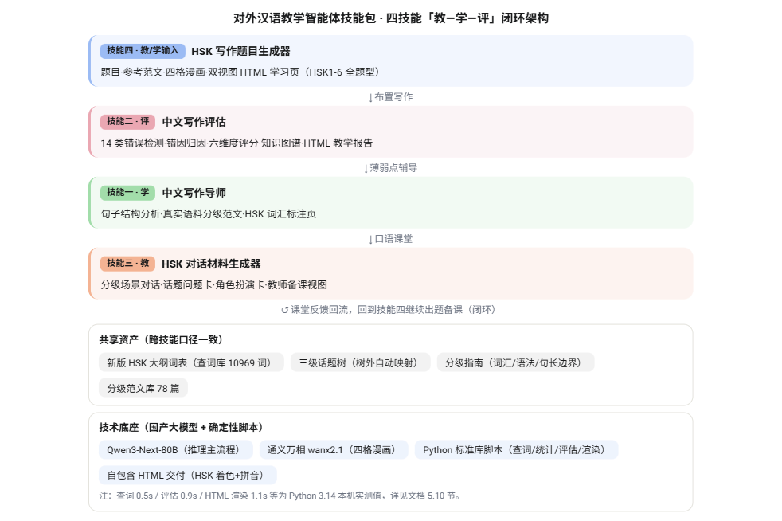
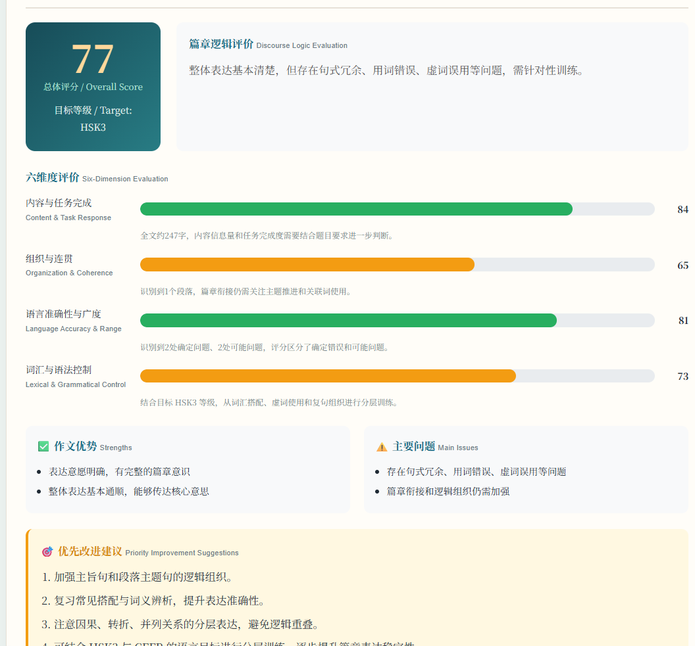
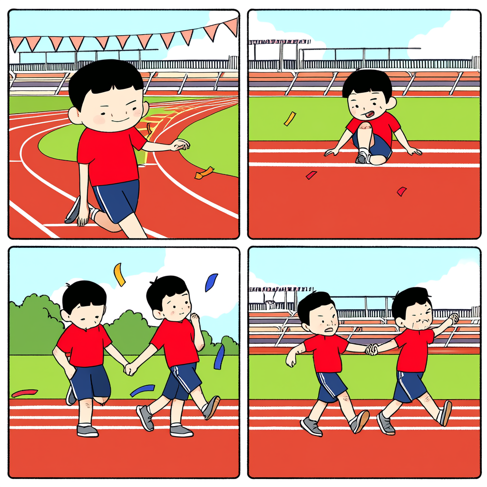
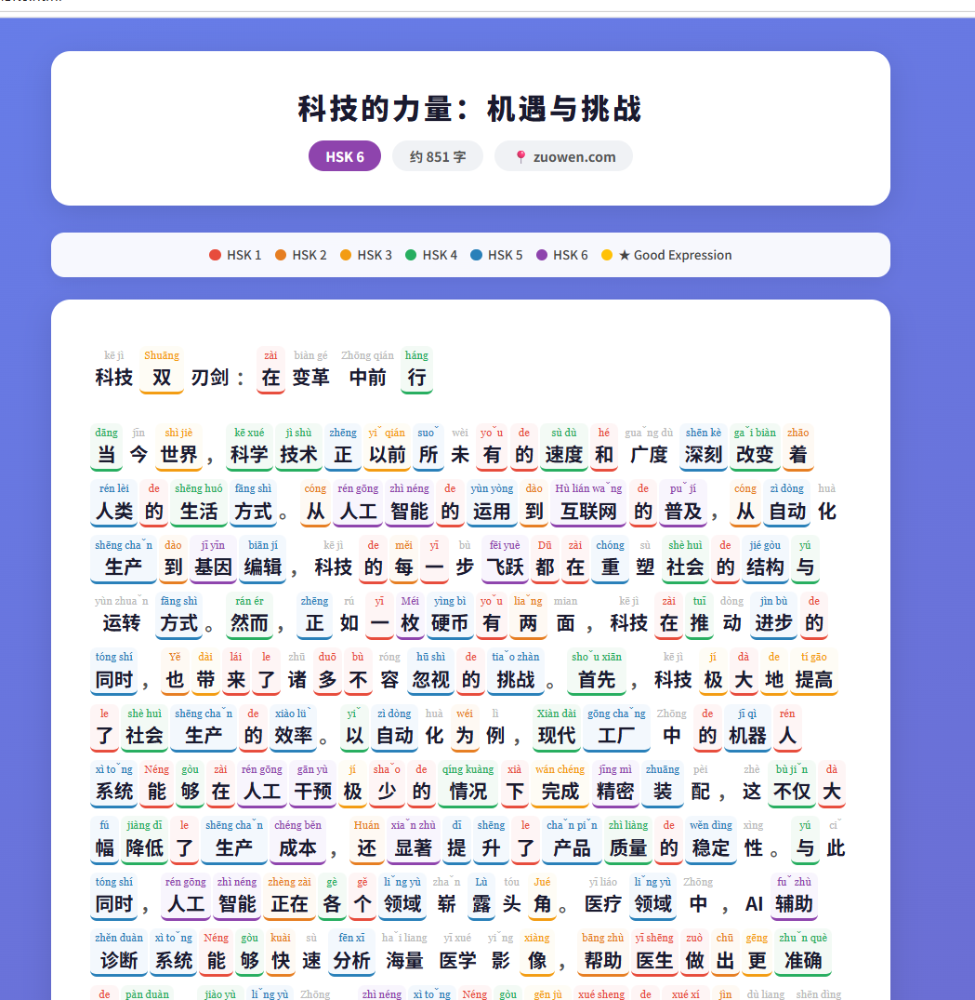
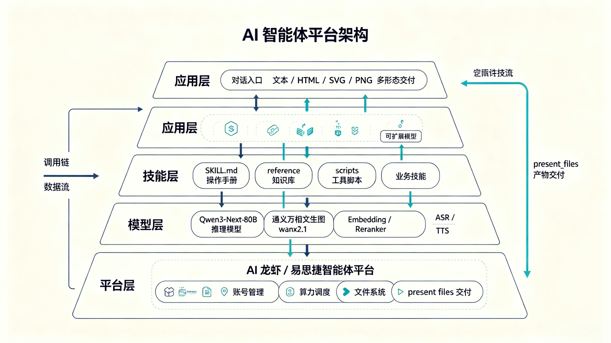

<div align="center">

# HSK TCSL Skills — 对外汉语教学智能体技能包

**面向国际中文学习者的等级可控（Level-Controlled）智能体 Skills 四件套**

基于国产大模型（Qwen 系列）与新版 HSK 大纲（2026-07 实施），覆盖 **教 · 学 · 评** 全闭环的 AI 教育 Skill 方案：
写作题目生成 → 口语对话材料 → 句子结构辅导 → 智能批改评估。

[](LICENSE)
[](skills/hsk-writing-generator-tcsl/scripts)
[-green)](docs/product-doc.pdf)


**Language-Controlled · Reproducible · Explainable**

</div>

---

## 目录

- [项目简介](#项目简介)
- [背景与痛点](#背景与痛点)
- [四大技能总览](#四大技能总览)
- [技术架构](#技术架构)
- [快速开始](#快速开始)
- [级控机制与可解释评估（创新点）](#级控机制与可解释评估创新点)
- [测试与性能](#测试与性能)
- [目录结构](#目录结构)
- [路线图](#路线图)
- [贡献指南](#贡献指南)
- [致谢](#致谢)

---

## 项目简介

本项目是一套**面向对外汉语教学（TCSL）**的智能体 Skill 开发成果，包含四个可独立部署、也可组合闭环使用的 AI 教育 Skills：

| # | 技能 | 定位 | 面向 |
|---|------|------|------|
| 1 | **中文写作导师** `chinese-writing-tutor-tcsl` | 句子结构分析 + 分级范文推荐 | 学习者 |
| 2 | **中文写作评估** `chinesewritingassessment-skill` | 错误定位 + 错因归因 + 六维评分 | 教师 / 学习者 |
| 3 | **HSK 对话材料生成器** `hsk-conversation-generator-tcsl` | 分级场景对话 + 话题卡 + 角色扮演卡 | 教师 |
| 4 | **HSK 写作题目生成器** `hsk-writing-generator-tcsl` | 全题型出题 + 参考范文 + 四格漫画 + 双视图 HTML | 教师 / 学习者 |

**核心设计原则**：语言等级可控（级控）。所有生成内容严格贴合 HSK 大纲等级边界——词汇、语法、句长、话题四类边界全部可控，超纲词一律显式标注（★ + 拼音 + 母语翻译），绝不静默放过。

> English: A suite of level-controlled AI Skills for Teaching Chinese as a Second Language (TCSL), built on Qwen models and the new HSK 3.0 syllabus (effective July 2026). Four Skills cover the full teaching–learning–assessment loop: writing-task generation, conversation material, sentence-structure tutoring, and essay assessment with explainable scoring.

### 演示

| 四技能闭环架构 | 六维评分报告 | 看图作文四格漫画 |
|---|---|---|
|  |  |  |

| 范文学习页（拼音标注） | 系统总体架构 |
|---|---|
|  |  |

完整产品技术文档（34 页，含需求分析、框架设计、测试用例、使用说明）：[docs/product-doc.pdf](docs/product-doc.pdf)

---

## 背景与痛点

国际中文教学对**语言等级精确性**要求极高，而通用大模型生成内容**等级不可控**——这是核心矛盾：

1. **教师备课耗时**：出题、找范文、准备口语材料成本高
2. **学生写作缺反馈**：写了没人批，批了讲不清错因
3. **范文难控级**：语料与 HSK 等级错配，超纲词难识别
4. **口语材料匮乏**：分级场景对话与角色扮演资源不足
5. **评估不可解释**：只给分数，不给错因与修改建议

因此本项目把 **「级控」** 作为全部四个技能的第一设计原则，并用**确定性脚本**保证结论可复现、可审计。

---

## 四大技能总览

### 1. 中文写作导师（chinese-writing-tutor-tcsl）

输入一句中文，无需标注等级，自动完成：

- 定位谓语动词 → 确定主语与宾语 → 标注定语 / 状语 / 补语
- 识别把字句、被字句、连动句等特殊句式
- 输出**结构图 + 英文语法贴士 + HSK 词汇表**
- 按目标等级推荐**分级范文**（全部经语法净化）

### 2. 中文写作评估（chinesewritingassessment-skill）

粘贴作文，一键生成可解释的评估报告：

- **14 类错误**逐条定位（原文片段 + 问题说明 + 修改建议）
- 区分**确定错误**与**可能问题**，不虚报
- **六维度加权评分**：内容 0.25 / 组织 0.25 / 语言准确性 0.35 / 词汇语法 0.15（+ 目标等级校准）
- 产出**自包含 HTML 教学报告**：HSK 等级着色、拼音标注、打印 / 下载

### 3. HSK 对话材料生成器（hsk-conversation-generator-tcsl）

- 分级**场景对话脚本** 40 组（HSK1-6）
- **话题问题卡** 24 组（热身 / 核心 / 拓展）
- **角色扮演任务卡** 24 个
- 输出教师备课视图 + 双视图学习页

### 4. HSK 写作题目生成器（hsk-writing-generator-tcsl）

- HSK1-6 **全题型**写作题：基础书写 / 短文 / 看图作文 / 引语作文 / 应用文 / 议论文
- 任意话题：先定位话题树，树外自动映射（不报错）
- 参考范文（本级词汇 + 超纲词 ★ 标注）+ 教师备课视图
- 看图作文**必出四格漫画**：千问 API 生图 → 平台生图 → 本地 SVG（三级路径自动降级）
- 生成**双视图 HTML 学习页**（学生练习版 + 教师版，可打印 / 下载）

---

## 技术架构

```
┌─────────────────────────────────────────────────────────┐
│ 应用层：对话入口 → 文本 / HTML / SVG / PNG 多形态产物     │
├─────────────────────────────────────────────────────────┤
│ 技能层：SKILL.md（操作手册）+ reference（知识库）          │
│         + scripts（确定性计算脚本）                       │
├─────────────────────────────────────────────────────────┤
│ 模型层：Qwen3-Next-80B（推理）· Qwen3-VL-32B（多模态）    │
│         Qwen3-Embedding-8B · Qwen3-Reranker-8B           │
│         Qwen3-ASR / Qwen3-TTS · 通义万相（生图）          │
├─────────────────────────────────────────────────────────┤
│ 平台层：AI 龙虾 / 易思捷超级智能体平台 · 国产芯片算力      │
└─────────────────────────────────────────────────────────┘
```

**脚本优先**：查词、统计、评估、漫画渲染、HTML 报告全部由 Python 标准库脚本完成——模型不手工标注、不臆造数据，**结果可复现、可审计**。

---

## 快速开始

### 方式一：导入智能体平台（推荐）

1. 在支持 SKILL.md 约定的智能体平台（如 AI 龙虾 / 易思捷超级智能体）中，逐个上传 `skills/` 下的四个技能目录（zip 或目录导入均可）
2. 平台将自动读取 `SKILL.md` 与 `manifest.yaml`，为模型注入操作手册与知识库
3. 直接对话使用

### 方式二：脚本独立运行（无需平台）

各技能 `scripts/` 下的脚本均为 Python 标准库实现（仅漫画 API 生图可选依赖密钥）：

```bash
# 查词（HSK 等级判定，超纲词标注）
python3 skills/hsk-writing-generator-tcsl/scripts/hsk_lookup.py --words "旅行,坚持,导航"

# 作文评估（错误定位 + 评分 + HTML 报告）
python3 skills/chinesewritingassessment-skill/scripts/assess_essay.py --text "我的作文内容..."

# 本地四格漫画渲染（零网络、零密钥）
python3 skills/hsk-writing-generator-tcsl/scripts/comic_render.py \
  --panels-json panels.json --output comic.svg --title "话题"
```

> 看图作文如需调用千问 API 生图：将 `api_key.txt.example` 复制为 `api_key.txt` 并填入密钥（**请勿将真实密钥提交到公开仓库**），或使用环境变量 `DASHSCOPE_API_KEY` / `QWEN_API_KEY`。

---

## 级控机制与可解释评估（创新点）

### 创新点 ①：级控机制 —— 等级边界由分级指南 + 词表脚本共同保证

| 边界 | 实现 |
|------|------|
| 词汇边界 | 新版 HSK 大纲词表核查（HSK1 155 / HSK2 160 / HSK3 313 / HSK4 602 / HSK5 1306 / HSK6 2516 条，共 5000+） |
| 语法边界 | 分级语法点清单，句式范围随等级递增 |
| 句长边界 | HSK1 ≤8 字/句，逐级放宽至 HSK6 ≤35 字 |
| 话题边界 | 三级话题树，树外话题自动映射到就近等级 |

**超纲词 ★ 标注（宁标勿漏）**：查词脚本逐词核查，查不到或超出目标等级的词一律显式标注 ★，并附拼音与母语翻译。实测：`旅行→HSK2`、`坚持→HSK3`、`导航→超纲★`。

### 创新点 ②：可解释评估引擎 —— 每条结论都可溯源

评估不只是总分：14 类错误检测 → 错因归因 + 知识图谱（实测 86 节点 / 72 边）→ 目标等级校准 → 确定性 JSON 输出（模型不增删任何结论）。生成自包含 HTML 教学报告，教师可直接发还学生。

---

## 测试与性能

| 项目 | 结果 |
|------|------|
| 功能测试 TC-01 ~ TC-25 | ✅ 全部通过（四技能分项） |
| 边界与异常测试 | ✅ 8 项（超纲词 / 空输入 / 长文本） |
| 性能指标 PF-01 ~ PF-08 | ✅ 全部达标 |

**关键路径实测**（Python 3.14 本机复现）：

| 环节 | 核心脚本 | 耗时 | 规模 |
|------|----------|------|------|
| 词表加载与查词 | `hsk_lookup.py` | ≈0.5s | 10969 词全表 |
| 作文智能评估 | `assess_essay.py` | ≈0.9s | 247 字 · 4 类错误 |
| HTML 报告渲染 | `render_essay_html.py` | ≈1.1s | 双视图 21KB |
| 四格漫画渲染 | `comic_render.py` | ≈0.6s | 本地 SVG |

**等级依据**：新版 HSK 大纲（2026-07 实施）、《国际中文教育中文水平等级标准》GF0025-2021、CEFR、ACTFL。

---

## 目录结构

```
hsk-tcsl-skills/
├── README.md                     # 本文件
├── LICENSE                       # MIT
├── .gitignore
├── assets/                       # 演示截图 / 架构图
├── docs/
│   └── product-doc.pdf           # 完整产品技术文档（34 页）
└── skills/
    ├── chinese-writing-tutor-tcsl/        # 技能一：中文写作导师
    ├── chinesewritingassessment-skill/    # 技能二：中文写作评估
    ├── hsk-conversation-generator-tcsl/   # 技能三：HSK 对话材料生成器
    └── hsk-writing-generator-tcsl/        # 技能四：HSK 写作题目生成器
        ├── SKILL.md              # 技能操作手册（模型读取）
        ├── manifest.yaml         # 技能元数据
        ├── reference/            # 知识库（词表 / 范文 / 指南 / 话题树）
        ├── scripts/              # 确定性计算脚本
        └── api_key.txt.example   # 密钥占位（请勿提交真实密钥）
```

每个技能目录结构统一：`SKILL.md`（模型操作手册）+ `manifest.yaml`（元数据）+ `reference/`（知识库）+ `scripts/`（工具脚本），可直接导入智能体平台。

---

## 路线图

- [x] v1.0：四技能开发与平台测试（初赛提交）
- [x] v2.0：级控机制强化、超纲词标注、HTML 双视图报告
- [ ] 多语种适配：日 / 韩 / 西 / 阿语学习者界面与语法对照
- [ ] 语音交互：接入 ASR / TTS，沉浸式听说训练
- [ ] 心理韧性筛查与情绪疏导（智慧学习方向）
- [ ] 校本知识库共建与教师共建语料
- [ ] 训练数据开源与评测基准发布

> 我们会**每周持续更新**。欢迎 Star ⭐ 关注，你的使用与反馈是我们继续迭代的最大动力！

---

## 贡献指南

- **提 Issue**：报告 bug、建议新功能、反馈教学场景需求
- **提 PR**：修复、文档、新语料、新脚本
- **数据合规**：引用外部语料请在 PR 中注明来源与授权

---

## 致谢

- 指导老师：于东教授（北京语言大学）
- 开发团队：北语信创队（北京语言大学信息科学学院）
- 开发平台：AI 龙虾 / 易思捷超级智能体平台（国产芯片算力）
- 模型底座：Qwen3 系列（Qwen3-Next-80B / Qwen3-VL-32B / Qwen3-Embedding-8B / Qwen3-Reranker-8B / Qwen3-ASR / Qwen3-TTS）、通义万相

---

<div align="center">

**让每一位国际中文学习者，都有像母语老师一样耐心、像考纲一样严格的智能学习伙伴。**

© 2026 北语信创队 · 第三届教育信息技术应用大赛 · 基于大模型教育教学应用创新赛（智能体 Skills 开发赛道）

</div>
