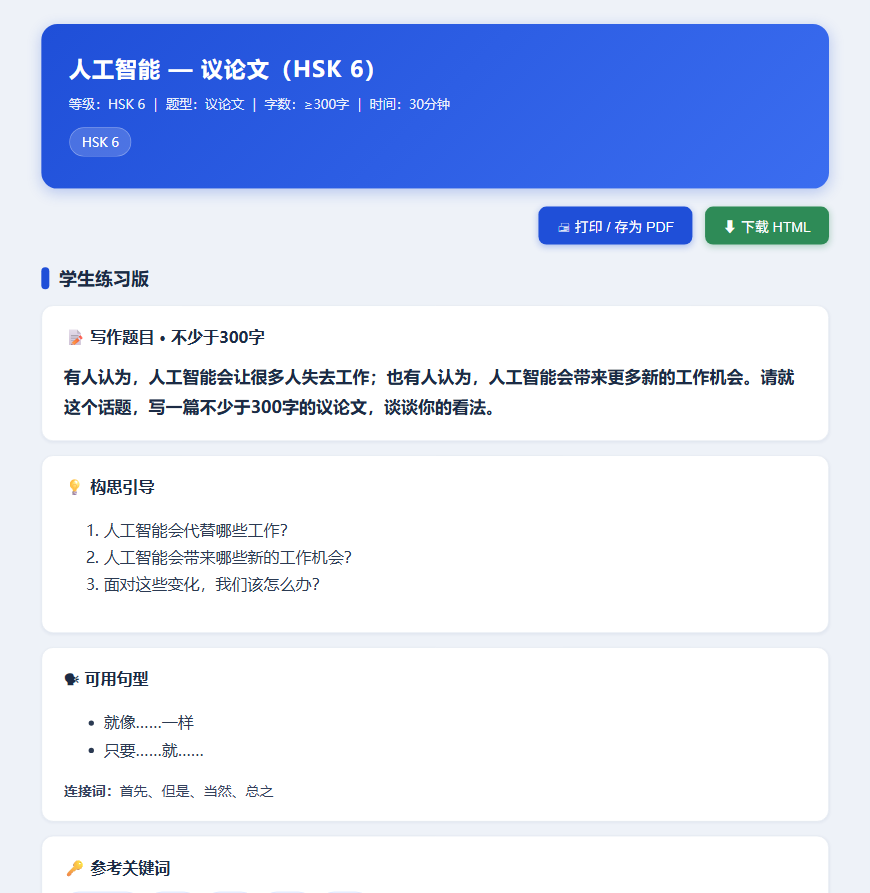
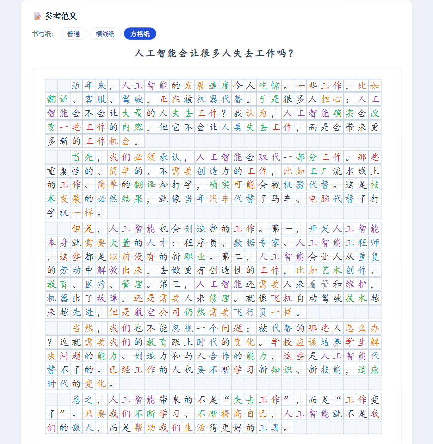
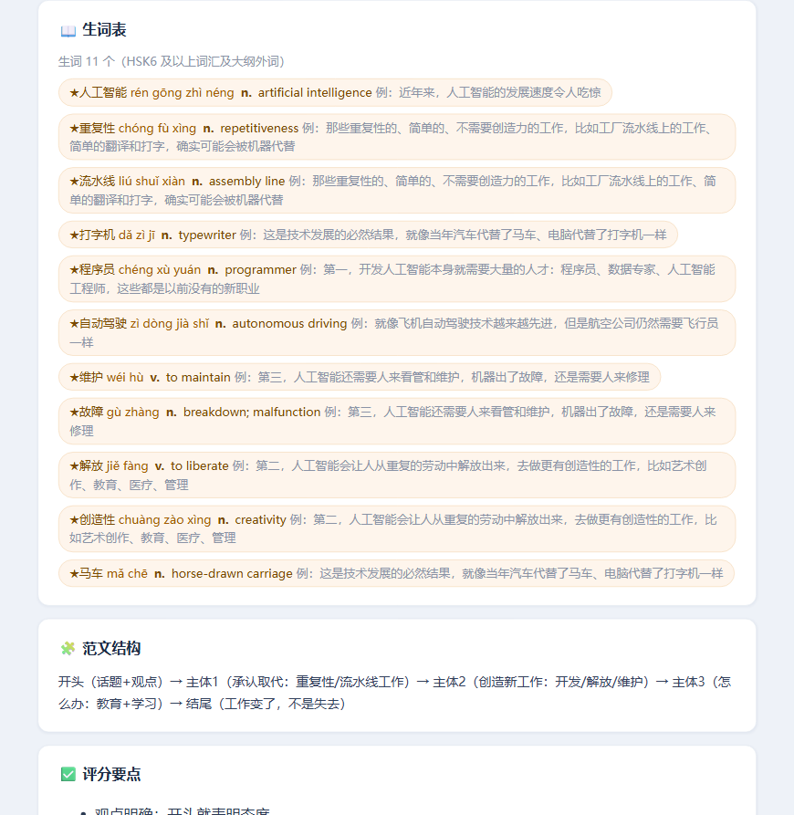
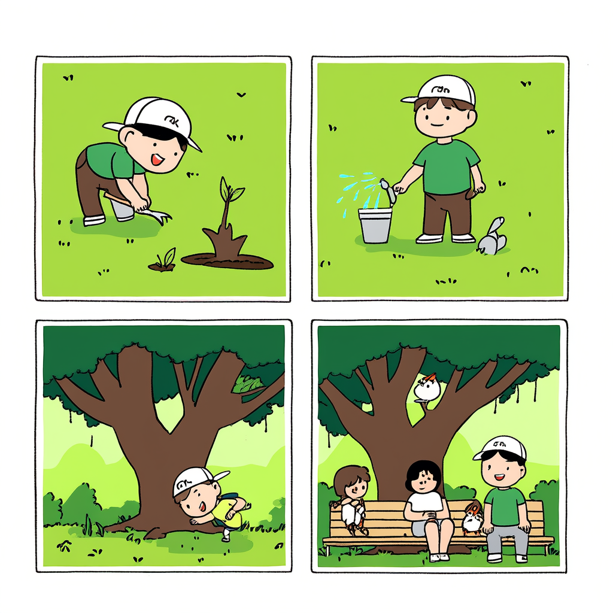

<div align="center">

# HSK 写作题目生成器 — hsk-writing-generator-tcsl

**跟 AI 说一句话，拿回一套能直接进课堂的 HSK 写作练习：题目 + 参考范文 + 方格纸学习页**

面向国际中文教师与学习者的 HSK 写作材料生成器 · 基于新版 HSK 大纲（2026-07 实施）

[](../../LICENSE)
[](scripts)
[-green)](https://github.com/jw-wuzhen/hsk-tcsl-skills)

</div>

---

## 它能做什么

用户说一句话，输出一整套写作练习材料：

| 输入 | 输出 |
|---|---|
| "HSK4 旅行作文" | 写作题目（含字数要求）+ 构思引导 + 可用句型 + 参考关键词 |
| "HSK5 看图作文，关于保护环境" | 四格漫画 + 看图作文全套材料 |
| "HSK6 议论文，人工智能会不会抢走人的工作？" | 按 HSK6 级控撰写的参考范文 + 生词表 |
| 任意一句话 + 等级 | 学生练习版 + 教师备课版双视图 HTML 学习页 |

覆盖 HSK1-6 **全部写作题型**：基础书写 / 短文（≥80字）/ 看图作文（≥100字）/ 引语作文（≥200字）/ 应用文（≥150字）/ 议论文（≥300字）。任意话题都能出题——话题树定位，树外话题自动映射，不会"报错罢工"。

## 效果长这样

| 学生练习版（题目+引导+句型+关键词） | 方格纸参考范文（字帖米字格，每行满格、段首空两格） |
|---|---|
|  |  |

| 生词表（★ + 拼音 + 词性 + 释义 + 原文例句） | 看图作文四格漫画（千问生图 · 保护环境，画质最佳；无密钥时本地兜底也能出图） |
|---|---|
|  |  |

## 为什么值得用

- **等级可控（核心设计）**：词汇、语法、句长、话题四类边界全部按新版 HSK 大纲卡死。目标等级及以上的词、以及词表查不到的词，一律收进【生词表】并标注（★ + 拼音 + 词性 + 释义 + 原文例句），**绝不静默放过**——杜绝低级别词汇混进生词表
- **作文纸还原书写场景**：方格纸（字帖米字格、每行满格、末行空格补齐、段落开头空两格）/ 横线纸（横线跟随每行字，行距即线距），一键切换，学生照着练格式
- **重点词句不脱离原文**：学习页只展示范文中实际出现的表达，例句直接从范文里带出来并高亮加粗——学词就学在句子里
- **看图作文必出四格漫画**：**推荐用千问生图**（画质最佳）→ 平台图像工具 → 本地 SVG 渲染，三级路径自动降级，**不配置任何密钥也能出图**
- **教师备课一站式**：教学信息、范文结构、评分要点、教学建议、级控自动检查（字数实算）都在同一份 HTML 里，可直接打印 / 存 PDF / 下载
- **零依赖**：全部为 Python 标准库脚本 + 自包含 HTML，可离线复现

## 快速开始

### 方式一：导入智能体平台（推荐）

1. 把 `hsk-writing-generator-tcsl/` 整个目录打包为 `.zip`
2. 在支持 SKILL.md 约定的智能体平台上传（平台自动读取 `manifest.yaml` 与 `SKILL.md`）
3. 直接对话使用：

```
"HSK4旅行作文"
"HSK5看图作文，四格图，关于保护环境"
"HSK6议论文，人工智能会不会抢走人的工作？要范文和教师视图"
"HSK2基础书写练习，介绍一下你的家人"
```

### 方式二：脚本独立运行（无需平台）

```bash
# 查词：判断词语的 HSK 等级（生词口径判定）
python3 scripts/hsk_lookup.py --words "旅行,坚持,导航"

# 本地四格漫画渲染（零网络、零密钥；纯几何简笔画，画质有限，仅作兜底）
python3 scripts/comic_render.py \
  --panels-json panels.json --output comic.svg --title "话题"

# 渲染 HTML 学习页（学生版 + 教师版，方格纸/横线纸，可打印/下载）
python3 scripts/render_essay_html.py \
  --essay-file essay_text.txt \
  --expressions-json expr.json \
  --teacher-json teacher.json \
  --output essay_话题_HSKx.html --hsk-level 5 --title "标题"
```

> **看图作文生图（推荐）**：建议配置千问 DashScope 密钥，运行 `comic_gen.py` 生成高画质 PNG 漫画（`--mode panels` 逐格 4 张 / `--mode single` 一张 2×2；密钥配置：环境变量 `DASHSCOPE_API_KEY`/`QWEN_API_KEY`、`--api-key` 参数，或技能包根目录 `api_key.txt`）。本地 SVG 画质有限，仅作无密钥时的兜底。

## 级控是怎么做到的

1. 词表核查：`reference/hsk_vocab.json`（2026 版 HSK 大纲分级词表，HSK1-6 + HSK7-9 合并）
2. 生词判定：**目标等级及以上词汇 + 词表查不到的词 = 生词**（如 HSK5 级别下，HSK5/6/7-9 及大纲外词均算生词）
3. 渲染脚本：`render_essay_html.py` 按词表最长匹配分词 → 逐词标注等级与拼音 → 生词着色并与生词表对齐 → 生成双视图 HTML

范文正文以目标等级**以下**词汇为主体书写，不可避免用到的生词显式标注；句长按等级卡边界（HSK1 ≤8 字/句，逐级放宽至 HSK6 ≤35 字）。拿不准的词用 `hsk_lookup.py` 查，查不到即按生词处理（宁标勿漏）。

## 目录结构

```
hsk-writing-generator-tcsl/
├── SKILL.md               # 模型操作手册（完整工作流，智能体平台读取）
├── manifest.yaml          # 技能元数据
├── assets/                # 演示截图
├── reference/             # 知识库
│   ├── hsk_vocab.json        2026版HSK分级词表（级控查词）
│   ├── char_pinyin.json      单字拼音表
│   ├── topic_tree.md         大纲话题树
│   ├── writing_guide.md      分级写作指南（能力/语法/题型模板）
│   └── model_essays/         分级范文库（短文/看图/引语/应用文/议论文）
└── scripts/               # 确定性计算脚本（纯标准库）
    ├── hsk_lookup.py         查词（生词判定）
    ├── text_stats.py         字数/句长统计
    ├── render_essay_html.py  HTML 学习页渲染（核心）
    ├── comic_render.py       本地四格漫画 SVG（零依赖兜底，画质有限）
    └── comic_gen.py          千问通义万相生图（推荐，画质最佳，需密钥）
```

## 面向开发者

- **SKILL.md** 是给模型的操作手册：触发词、Step 1-7 工作流、输出模板、错误处理，模型按手册直接生成内容
- **reference/** 是生成时的知识锚点（词表/话题树/写作指南/范文样例），保证等级可控
- **scripts/** 是确定性脚本：模型不手工标注、不臆造数据，结果可复现、可审计
- 脚本自测命令见"快速开始 · 方式二"

## 开源与反馈

本项目基于 MIT License 开源。欢迎：

- ⭐ **Star** 关注项目动态
- 提 **Issue** 报告 bug、建议新功能、反馈教学场景需求
- 提 **PR** 修复问题、补充语料、完善文档

> 数据合规：引用外部语料请在 PR 中注明来源与授权。

---

<div align="center">

**让每一位国际中文学习者，都有像考纲一样严格、像老师一样耐心的智能写作陪练。**

</div>
